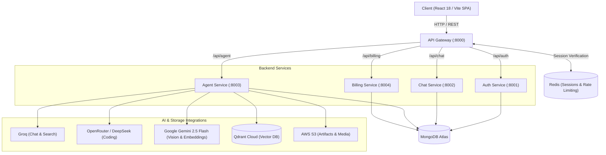

# CortexAI 🧠⚡

> **An Autonomous Multi-Agent AI Platform & Microservices Orchestrator**  
> Powered by LangChain, LangGraph, Multi-Model Dynamic Routing, and a Distributed Node.js Microservices Architecture.

---

## 🚀 Overview

**CortexAI** is a production-grade, distributed AI platform designed to deliver specialized autonomous agents through an intelligent microservices architecture. It dynamically routes user requests across specialized LLMs (Groq, DeepSeek via OpenRouter, and Google Gemini), integrates vector retrieval for PDF intelligence, and generates downloadable artifacts (codebases, slide presentations, and formatted documents) stored in AWS S3 with local offline fallbacks.

---

## 🌟 Key Features

### 🤖 Specialized Autonomous Agents
* **💬 General Chat Agent:** High-throughput, sub-second latency conversational assistant powered by **Groq LPUs**.
* **💻 Coding Agent:** Generates, reviews, and refactors multi-file projects powered by **DeepSeek (OpenRouter)** with self-healing JSON output parsers, syntax-guardrails, and Monaco Editor integration.
* **📊 Presentation Agent (PPT):** Programmatically constructs multi-slide presentation decks (`.pptx`) and generates shareable download links.
* **📄 Document Agent (PDF):** Compiles structured reports and documentation into downloadable PDF artifacts.
* **🔍 Document Intelligence (PDF RAG):** Ingests PDFs into **Qdrant Vector DB** using Google Generative AI Embeddings for hallucination-resistant semantic question answering.
* **👁️ Vision Analyzer:** Multimodal image inspection and diagram breakdown powered by **Google Gemini 2.5 Flash**.
* **🌐 Web Search Agent:** Real-time web grounding and synthesis powered by **Tavily AI**.

### 🏗️ Microservices Architecture
* **API Gateway (`:8000`):** Single entry point handling authentication verification, Redis-backed rate-limiting, CORS, and reverse-proxy routing.
* **Auth Service (`:8001`):** User management, Google OAuth via Firebase Admin SDK, and secure HTTP-only cross-origin session cookies.
* **Chat Service (`:8002`):** Persistent conversation histories, thread management, and message storage in MongoDB.
* **Agent Service (`:8003`):** StateGraph workflow execution using LangGraph, dynamic LLM dispatch, S3 presigned asset delivery, and vector search.
* **Billing Service (`:8004`):** Razorpay payment gateway integration, subscription plans, and atomic credit decrement per AI invocation.
* **Frontend (`:5173` / `:5174`):** Modern React 18 SPA built with Vite, Tailwind CSS, Redux Toolkit, Monaco Editor, and interactive artifact viewer for live code and document previews.

---

## 🏛️ System Architecture



---

## 🛣️ Gateway Routing Table

| Route | Purpose | Authentication |
|---|---|---|
| `/api/auth` | Login, Google OAuth token verification, logout | Public / Service-dependent |
| `/api/me` | Fetch active authenticated user profile | Required (Session Cookie) |
| `/api/chat` | Create conversations, fetch message history | Required (Session Cookie) |
| `/api/agent` | Execute AI agents (Chat, Coding, PPT, PDF, Vision, RAG) | Required (Session Cookie) |
| `/api/billing` | Razorpay order creation, payment verification, credits | Required (Session Cookie) |

---

## 📦 Tech Stack

| Domain | Technologies |
|---|---|
| **Frontend** | React 18, Vite, Redux Toolkit, Tailwind CSS, Monaco Editor, React Markdown, Axios |
| **Backend & Microservices** | Node.js, Express.js, Docker, Docker Compose, HTTP-Proxy |
| **AI & Orchestration** | LangChain, LangGraph (StateGraph), Groq SDK, Google GenAI SDK |
| **Databases & Cache** | MongoDB (Mongoose), Redis (ioredis), Qdrant Cloud (Vector Search) |
| **Cloud & Storage** | AWS S3 (Presigned URLs & Local Fallback), AWS IAM |
| **Auth & Payments** | Firebase Auth (Admin SDK), Razorpay Payments |

---

## 📂 Project Structure

```text
Cortex-AI/
├── frontend/                     # React 18 + Vite client application
├── backend/
│   ├── gateway/                  # API Gateway (Port 8000)
│   ├── shared/                   # Shared Redis clients & utility modules
│   └── services/
│       ├── auth/                 # Authentication service (Port 8001)
│       ├── chat/                 # Conversation & message service (Port 8002)
│       ├── agent/                # Multi-Agent LangGraph engine (Port 8003)
│       └── billing/              # Razorpay billing & credits (Port 8004)
├── CREDENTIALS_AND_DEPLOYMENT_GUIDE.md  # Step-by-step API keys & cloud setup guide
├── start-dev.js                  # Master concurrent runner for all services
└── package.json                  # Root orchestration package
```

---

## ⚡ Quick Start

### 1. Prerequisites
* **Node.js** v18+ and **npm**
* **MongoDB** (local `mongodb://localhost:27017` or MongoDB Atlas)
* **Redis** (local `redis://localhost:6379`, local Docker container, or Upstash)

### 2. Clone & Install Dependencies
```bash
git clone https://github.com/viditsharma1405/Cortex-AI.git
cd Cortex-AI

# Install root dependencies
npm install

# Install all microservices dependencies
npm run install:all
```

### 3. Configure Environment Variables
Copy the `.env.example` templates in each service directory and populate your credentials:

```bash
cp frontend/.env.example frontend/.env
cp backend/gateway/.env.example backend/gateway/.env
cp backend/services/auth/.env.example backend/services/auth/.env
cp backend/services/chat/.env.example backend/services/chat/.env
cp backend/services/agent/.env.example backend/services/agent/.env
cp backend/services/billing/.env.example backend/services/billing/.env
```

> 📖 **Need API keys?** See [CREDENTIALS_AND_DEPLOYMENT_GUIDE.md](./CREDENTIALS_AND_DEPLOYMENT_GUIDE.md) for step-by-step instructions to obtain free-tier keys for Firebase, Groq, OpenRouter, Gemini, Tavily, Qdrant, and Razorpay.

### 4. Run Everything in Development Mode
Start all 6 microservices concurrently with a single command:
```bash
npm run dev
```

This launches:
* **Frontend:** `http://localhost:5173` (or `5174`)
* **API Gateway:** `http://localhost:8000`
* **Auth Service:** `http://localhost:8001`
* **Chat Service:** `http://localhost:8002`
* **Agent Service:** `http://localhost:8003`
* **Billing Service:** `http://localhost:8004`

---

## 🚢 Production Deployment

For full cloud deployment details (AWS S3, CloudFront, EC2, ECS Fargate, ALB, and DNS), refer to the comprehensive [CREDENTIALS_AND_DEPLOYMENT_GUIDE.md](./CREDENTIALS_AND_DEPLOYMENT_GUIDE.md).

### Docker Deployment
Each service includes a production-ready `Dockerfile`:
```bash
# Build Gateway
docker build -t cortex-gateway -f backend/gateway/Dockerfile backend/

# Build Services
docker build -t cortex-auth -f backend/services/auth/Dockerfile backend/
docker build -t cortex-chat -f backend/services/chat/Dockerfile backend/
docker build -t cortex-agent -f backend/services/agent/Dockerfile backend/
docker build -t cortex-billing -f backend/services/billing/Dockerfile backend/
```

---

## 🛡️ License

This project is licensed under the MIT License.
